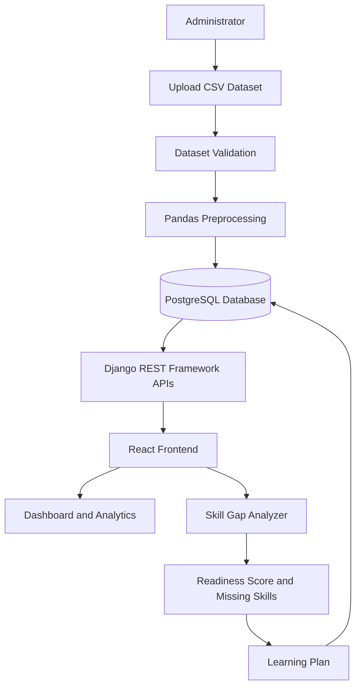

# SOFTWARE REQUIREMENTS SPECIFICATION (SRS)

# IT Skills Demand Explorer

**Project Name:** IT Skills Demand Explorer  
**Prepared By:** Siddhi Jagtap  
**Batch:** 45  
**Project Type:** Full Stack Web Application  
**Document Version:** 1.0

---

# 1. Introduction

## 1.1 Purpose

The purpose of IT Skills Demand Explorer is to analyze IT job posting data and identify the most in-demand technical skills across different IT job roles.

The application helps students and job seekers understand current industry requirements, compare different career roles, analyze skill demand, and identify the skills they need to develop to improve their career readiness.

The system uses data analysis techniques to convert job posting information into meaningful insights through interactive dashboards and visualizations.

## 1.2 Problem Statement

The IT industry continuously changes, and the technical skills required for different job roles also change over time.

Students and fresh graduates often face difficulties in identifying:
- Which technical skills are currently in demand.
- Which skills are required for a particular job role.
- How two different IT job roles differ in their skill requirements.
- What salary and experience levels are associated with different roles.
- Which skills they are missing for their desired career.

Without proper analysis of job market information, students may spend time learning skills that are less relevant to their career goals.

Therefore, IT Skills Demand Explorer aims to provide a centralized platform that analyzes job posting datasets and generates useful career-related insights.

## 1.3 Project Objectives

The main objectives are:

1. Analyze IT job posting datasets using Python and Pandas.
2. Identify the most demanded technical skills across IT job roles.
3. Display role-wise skill demand through interactive dashboards.
4. Compare the skill requirements of two job roles.
5. Analyze changes in skill demand over time.
6. Provide salary and experience-related insights.
7. Calculate a career readiness score based on existing skills.
8. Identify missing skills for a selected job role.
9. Generate prioritized skill development plans.
10. Allow users to save and manage their learning plans.

## 1.4 Project Scope

The project focuses on analyzing structured IT job posting datasets uploaded by an administrator.

The application includes:
- User registration and authentication.
- Role-based authorization.
- CSV dataset upload and validation.
- Data cleaning and preprocessing.
- Skills demand analysis.
- Job role comparison.
- Skill trend analysis.
- Salary and experience analysis.
- Skill gap analysis.
- Career readiness score calculation.
- Personalized learning plans.
- Interactive dashboards and reports.
- API documentation and testing.

### Out of Scope

The following functionalities are not included in the initial project scope:

- Live job scraping from external job portals.
- Automatic job applications.
- Direct communication with recruiters.
- Resume uploading and resume checking.
- Paid course hosting or payment processing.
- Guaranteed job placement recommendations.

---

# 2. Target Users

The system is designed for the following users:

1. **Students:** To understand the technical skills required for different IT job roles.
2. **Fresh Graduates:** To identify skill gaps before applying for jobs.
3. **Job Seekers:** To compare career opportunities and improve existing skills.
4. **Administrators:** To manage datasets, users, roles, and skills.

---

# 3. User Roles and Responsibilities

The application supports two primary user roles.

## 3.1 Administrator

Responsibilities:

- Login to the administrative section.
- Upload job posting datasets.
- Validate uploaded CSV files.
- Manage uploaded datasets.
- Add, update, and delete job roles.
- Manage technical skills.
- View and manage registered users.
- Monitor dataset processing.

## 3.2 Registered User

Responsibilities:

- Register and login to the application.
- View the skills demand dashboard.
- Explore different IT job roles.
- Compare two job roles.
- View skill demand trends.
- Analyze salary and experience insights.
- Select a target job role.
- Select already known skills.
- View readiness score and missing skills.
- Generate and save learning plans.
- View and delete saved plans.

---

# 4. Functional Requirements

## FR-01: User Registration

The system shall allow new users to register using their basic account details.

The system shall validate registration inputs and prevent duplicate accounts.

## FR-02: User Authentication

The system shall allow registered users to login and logout securely.

The system shall verify user identity before providing access to protected resources.

## FR-03: Role-Based Authorization

The system shall restrict administrative functionalities to authorized administrators.

Normal registered users shall not be allowed to access administrative operations.

## FR-04: Dataset Upload

The administrator shall be able to upload job posting datasets in CSV format.

The maximum permitted upload size shall be 20 MB.

## FR-05: Dataset Validation

The system shall validate:
- File format.
- File size.
- Required column names.
- Data types.
- Missing and invalid values.

Invalid datasets shall produce appropriate error messages.

## FR-06: Data Preprocessing

The system shall use Pandas to clean and preprocess uploaded job posting data.

Preprocessing may include:
- Removing duplicate records.
- Handling missing values.
- Normalizing skill names.
- Validating dates.
- Converting data into suitable formats.

## FR-07: Skills Demand Dashboard

The system shall display:
- Total job postings.
- Available job roles.
- Most demanded technical skills.
- Role-wise skill demand.
- Skill demand percentages.

## FR-08: Job Role Comparison

The system shall allow users to select two job roles and compare their required technical skills.

## FR-09: Skill Trend Analysis

The system shall analyze historical job posting dates and display changes in skill demand over time.

## FR-10: Salary and Experience Analysis

The system shall provide salary and experience insights based on the available dataset.

## FR-11: Skill Gap Analysis

The system shall allow users to select a target job role and their existing technical skills.

The application shall compare selected skills with the skills required for that role.

## FR-12: Readiness Score Calculation

The system shall calculate a readiness percentage based on the demand percentage of the user's existing skills.

## FR-13: Learning Priority

The system shall identify missing skills and arrange them according to their demand in the selected job role.

## FR-14: Learning Plan Management

The system shall allow users to:
- Generate learning plans.
- Save learning plans.
- View saved plans.
- Delete saved plans.

## FR-15: Search and Filters

The application shall provide filters based on:
- Job role.
- Location.
- Experience range.
- Skill.

## FR-16: API Communication

The React frontend shall communicate with the Django REST Framework backend through REST APIs.

The backend shall validate requests and return appropriate JSON responses.

---

# 5. Non-Functional Requirements

## 5.1 Performance

The application should process datasets efficiently and return analytical results within a reasonable time.

## 5.2 Security

- Passwords must be securely hashed.
- Protected APIs must require authentication.
- Role-based permissions must be enforced on the backend.
- Users must only access their own saved learning plans.
- Uploaded files must be validated.

## 5.3 Usability

The interface should be simple, responsive, and user-friendly.

## 5.4 Reliability

The application should handle invalid inputs, missing data, and API errors without unexpected crashes.

## 5.5 Maintainability

The application should follow modular architecture and proper coding standards.

## 5.6 Scalability

The system should support future enhancements such as additional job roles and larger datasets.

## 5.7 Compatibility

The application should work on modern web browsers and different screen sizes.

---

# 6. Main System Modules

The application is divided into the following modules.

## 6.1 Authentication Module

- User registration.
- Login and logout.
- Authentication verification.
- Role-based access control.

## 6.2 Dataset Management Module

- CSV upload.
- Dataset validation.
- Data cleaning.
- Duplicate removal.
- Dataset storage and management.

## 6.3 Analytics Module

- Overall skill demand analysis.
- Role-wise skill analysis.
- Job role comparison.
- Skill trends.
- Salary analysis.
- Experience analysis.

## 6.4 Skill Gap Analysis Module

- Target role selection.
- Existing skill selection.
- Missing skill identification.
- Readiness score calculation.
- Learning priority generation.

## 6.5 Learning Plan Module

- Generate learning plans.
- Save plans.
- View saved plans.
- Delete plans.

## 6.6 Dashboard Module

- Display analytical summaries.
- Interactive charts.
- Skill demand visualizations.
- Filters and search functionality.

## 6.7 Administration Module

- User management.
- Role management.
- Skill management.
- Dataset management.

---

# 7. Use Cases

## 7.1 Use Case: User Registration

**Actor:** New User

**Precondition:** User does not already have an account.

**Main Flow:**
1. User opens the registration page.
2. User enters the required details.
3. System validates the information.
4. System creates the user account.
5. User receives registration confirmation.

**Postcondition:** User account is created successfully.

## 7.2 Use Case: User Login

**Actor:** Registered User

**Precondition:** User has a valid account.

**Main Flow:**
1. User enters login credentials.
2. System validates credentials.
3. System authenticates the user.
4. User is redirected to the dashboard.

**Postcondition:** User receives access according to their role.

## 7.3 Use Case: Upload Dataset

**Actor:** Administrator

**Precondition:** Administrator is authenticated.

**Main Flow:**
1. Administrator opens dataset management.
2. Administrator selects a CSV file.
3. System validates the file.
4. Pandas processes the dataset.
5. Valid records are stored in PostgreSQL.
6. System displays upload status.

**Postcondition:** Valid dataset is available for analysis.

## 7.4 Use Case: Analyze Skill Demand

**Actor:** Registered User

**Precondition:** A valid dataset is available.

**Main Flow:**
1. User opens the dashboard.
2. User selects a job role.
3. System retrieves relevant job postings.
4. System calculates skill demand.
5. Dashboard displays analytical results.

**Postcondition:** User can view role-wise skill demand.

## 7.5 Use Case: Compare Job Roles

**Actor:** Registered User

**Main Flow:**
1. User selects two job roles.
2. System retrieves their skill requirements.
3. System compares the skills.
4. System displays comparison results.

**Postcondition:** User understands differences between the selected roles.

## 7.6 Use Case: Skill Gap Analysis

**Actor:** Registered User

**Precondition:** User is authenticated and job posting data is available.

**Main Flow:**
1. User selects a target job role.
2. User selects already known skills.
3. System retrieves the top demanded skills for the role.
4. System identifies missing skills.
5. System calculates the readiness score.
6. System generates learning priorities.

**Postcondition:** User receives a personalized skill gap report.

## 7.7 Use Case: Save Learning Plan

**Actor:** Registered User

**Precondition:** A learning plan has been generated.

**Main Flow:**
1. User selects the save option.
2. System stores the learning plan.
3. User can view it later.
4. User can delete it when required.

**Postcondition:** Learning plan is stored under the user's account.

---

# 8. Project Workflow

The overall workflow of the application is:

1. Administrator logs in.
2. Administrator uploads a job posting CSV dataset.
3. System validates the uploaded file.
4. Pandas cleans and preprocesses the data.
5. Processed records are stored in PostgreSQL.
6. Django REST APIs provide the processed data.
7. React frontend requests data from the backend.
8. Dashboard displays skill demand and job market insights.
9. User selects a target job role.
10. User selects existing technical skills.
11. System calculates the readiness score and missing skills.
12. User saves the generated learning plan.

## 8.1 System Data Flow

---

# 9. Database Requirements and Relationships

The application shall use PostgreSQL as its primary relational database.

The database shall contain the following main entities:

| Entity | Description |
|---|---|
| User | Stores registered user information and roles |
| Dataset | Stores uploaded dataset details |
| Role | Stores available IT job roles |
| Skill | Stores technical skill information |
| JobPosting | Stores individual job posting records |
| SavedPlan | Stores user learning plans |

## 9.1 Database Relationships

1. One dataset can contain multiple job postings.
2. One role can be associated with multiple job postings.
3. One job posting can require multiple skills.
4. One skill can be associated with multiple job postings.
5. One user can create multiple saved learning plans.
6. One saved learning plan belongs to one user.
7. One saved learning plan is associated with one target role.
8. One saved learning plan can contain multiple known skills.

The relationship between JobPosting and Skill shall be many-to-many.

The relationship between User and SavedPlan shall be one-to-many.

---

# 10. Business Logic and Calculations

## 10.1 Skill Demand Percentage

The skill demand percentage is calculated as:

**Skill Demand Percentage = (Number of job postings mentioning the skill / Total job postings for the selected role) × 100**

Example:

If 80 out of 100 Data Analyst job postings mention SQL:

SQL Demand = (80 / 100) × 100 = 80%

## 10.2 Readiness Score

The readiness score is calculated using:

**Readiness Score = (Sum of demand percentages of known skills / Sum of demand percentages of the top 15 demanded skills) × 100**

Example:

For a Data Analyst role:

| Skill | Demand |
|---|---:|
| SQL | 80% |
| Excel | 70% |
| Python | 65% |
| Power BI | 55% |
| Tableau | 40% |

If a user knows SQL, Excel, and Python:

Readiness Score = (80 + 70 + 65) / (80 + 70 + 65 + 55 + 40) × 100

Readiness Score = 280 / 310 × 100

Readiness Score = 90..32%

This score represents the percentage of demand covered by the skills already known by the user.

## 10.3 Learning Priority

Missing skills shall be arranged in descending order of their demand percentages.

For example:
1. Power BI – 55%
2. Tableau – 40%

The system shall recommend learning the most demanded missing skills first.